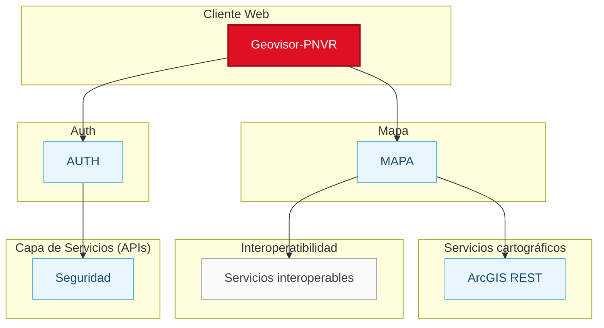

# Aplicativo Visor Geográfico del Programa Nacional de Vivienda Rural (PNVR)

Aplicación frontend desarrollada con **Angular 20**.

---

## 🚀 Tecnologías

- Angular 20.0.0
- TypeScript
- RxJS
- Angular CLI
- HTML5 / TAILWIND
- Node.js ≥ 20

---

## 📦 Requisitos previos

- Node.js 20 o superior
- npm 9+ o yarn
- Angular CLI

```bash
npm install -g @angular/cli
```

---


## 🔐 Configuración de entornos

Los entornos se configuran en:

```
src/environments/
```

### Ambientes disponibles

| Archivo | Ambiente | Servicios cartográficos |
|---|---|---|
| `environment.ts` | **Desarrollo** | ArcGIS REST y mapas base |
| `environment.qa.ts` | **QA** | ArcGIS REST y mapas base |
| `environment.prod.ts` | **Producción** | ArcGIS REST y mapas base |

Los tres archivos se generan con la fábrica `crearEnvironment()` de
`src/environments/environment.model.ts`, que centraliza toda la configuración
(DataGIS, TUSNE, APIs WSGEOVISOR, Observatorio Urbano, etc.). El mapa consume
ArcGIS REST y los servicios de mapas base; GeoServer ya no forma parte del visor.
El panel de capas incorpora el servicio COEN FEN 2027 de CENEPRED respetando su
jerarquía publicada: FEN 2027, grupos temáticos y subcapas individuales.
El servicio de límites del Perú expone sus 12 subcapas, organizadas en vías,
hidrografía, límites administrativos y centros poblados.
También incluye las ortofotos publicadas por IDEP en `IMAGENES`, agrupadas en el
árbol `ORTOFOTOS`.
Si algún servidor interno cambia por ambiente, se pasa como override:

```ts
export const environment = crearEnvironment({
  production: true,
  ambiente: 'Producción',
  // overrides opcionales de servidores internos:
  // dataGisServerUrl, tusneServerUrl
});
```

### Publicación de prueba en Netlify

El proyecto incluye `netlify.toml` y `public/_redirects`. Para desplegarlo:

1. Importa el repositorio en Netlify y deja que detecte `netlify.toml`.
2. `npm run build:netlify` genera un build optimizado con la configuración de
   QA; Netlify publica `dist/visor_pnsr/browser`.
3. Las rutas de Angular se sirven mediante el fallback SPA de `_redirects`, y
   `/WSGEOVISOR/*` se proxifica al backend de pruebas
   (`https://test.munisanisidro.gob.pe`).

La previsualización no reemplaza el acceso a la red institucional: los servicios
DataGIS y TUSNE configurados con IP privadas (`192.168.x.x`) no son accesibles
desde Netlify. Para probar esas funciones se necesita publicar esos servicios
mediante un backend accesible o conectarse a una red/VPN con acceso apropiado.

### Comandos por ambiente

#### 🧑💻 Desarrollo

```bash
# Levantar el servidor de desarrollo (http://localhost:4200 · usa proxy.conf.json)
npm start

# Build de desarrollo (sin optimizar y con sourcemaps) → dist/visor_pnsr/browser
ng build --configuration development

# Build de desarrollo en modo watch (recompila automáticamente al guardar)
npm run watch
```

#### 🏭 Producción

```bash
# Build de producción (optimizado, con hashing y environment.prod.ts)
npm run build:prod          # equivale a: ng build -c production

# Atajo: 'npm run build' TAMBIÉN compila producción, porque el
# defaultConfiguration del target build es "production" (ver angular.json)
npm run build               # equivale a: ng build -c production
```

> ⚠️ **Ojo:** `npm run build` **no** compila para desarrollo: por defecto usa la
> configuración `production` (`defaultConfiguration: "production"` en
> `angular.json`). Para un build de desarrollo usa `ng build --configuration
> development` o `npm run watch`.

#### 🔍 QA (referencia)

```bash
npm run start:qa            # servir la configuración QA localmente
npm run build:qa            # compilar para QA (equivale a: ng build -c qa)
```

**Salida del build:** `dist/visor_pnsr/browser/` (contiene el `index.html` y los
`.js`/`.css` con hash de contenido, listos para publicar en Nginx).

La selección del ambiente se hace mediante `fileReplacements` en
`angular.json`: la configuración `qa` sustituye `environment.ts` por
`environment.qa.ts` y la configuración `production` por `environment.prod.ts`,
de modo que el bundle final solo contiene las URLs del ambiente elegido.

---


## 📏 Estándares y buenas prácticas

- Arquitectura modular
- Lazy loading para módulos
- Tipado estricto habilitado
- ESLint configurado
- Angular Style Guide
- Separación clara de responsabilidades

---

## 🔀 Flujo de trabajo Git

- Rama principal: `main`
- Desarrollo y Producción: `main`
- Features: `feature/hu*`
- Fixes: `hotfix/*`


---

## 📦 Diagrama de componentes:


---

## 🌍 Links de las publicaciones:

[Local](http://localhost:4200/)

Producción: URL institucional configurada para el PNVR. Las capas del mapa se
consumen desde ArcGIS REST y los servicios de mapas base.